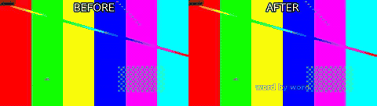
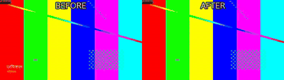
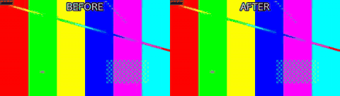
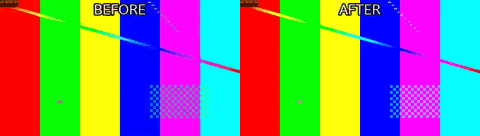
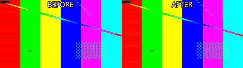
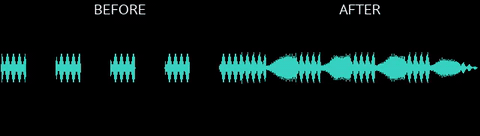
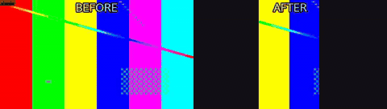

<div align="center">



[](https://github.com/chandandigital-cms/CDVEA/releases/latest)
[](LICENSE)
[](SETUP-GUIDE.md)
[](SETUP-GUIDE.md)
[](SETUP-GUIDE.md)
[](CAPABILITIES.md)

<a href="https://github.com/chandandigital-cms/CDVEA/releases/latest/download/CDVEA.zip"></a>
<a href="SETUP-GUIDE.md"></a>

<sub>Needs <a href="https://www.python.org/downloads/windows/">Python 3.10+</a> and <a href="https://www.gyan.dev/ffmpeg/builds/">FFmpeg 6.1+</a>. Setup downloads the speech model and the rest automatically.</sub>

**[Install with AI](#-install-with-your-ai-agent)** · **[Quick start](#-quick-start-windows)** · **[Features](#-features)** · **[Demos](#-see-it-work)** · **[Prompts](#-ask-in-english-or-bengali)** · **[FAQ](#-faq)**

</div>

# CDVEA — AI Video Editing Agent for Claude Code & Codex

**CDVEA** (by Chandan Digital) is an open-source **AI video editing plugin** that turns Claude Code or Codex into a local video editor. Describe the edit in plain **English or Bengali**. CDVEA plans it, cuts the footage with **FFmpeg**, cleans and mixes the sound, burns in **Bengali, Hindi or English subtitles**, adds titles and motion graphics, and exports masters for YouTube, Instagram Reels and Shorts.

Everything core runs **on your own computer**. Your footage is not uploaded, and there is no cloud render step.

> 30 skills · 8 specialist agents · 9 slash commands · 49 MCP tools · one-time Windows setup

## ✨ Why CDVEA

- **Edit by conversation:** "Make a 30-second promo with Bengali captions and a vertical Short" is a complete instruction.
- **Local and private:** Python + FFmpeg on your machine. Optional speech models load only for a transcription job.
- **A full post-production crew:** a director, editor, sound editor, caption editor, motion designer, media analyst, delivery editor and an independent reviewer.
- **Indic captions done properly:** Bengali and Hindi caption review, retiming and font checks, plus English.
- **Reproducible:** edits live in a plan file you can validate, re-render and hand over as an EDL cut list.

## 🎬 How it works



1. **Footage:** probe files, detect scenes, transcribe speech with word timestamps.
2. **Cut:** trim, join, speed ramps, remove long pauses and filler words, multicam switching.
3. **Sound:** voice cleanup, music ducking, loudness normalisation (LUFS).
4. **Captions:** SRT, karaoke and word-by-word captions; Bengali/Hindi retiming.
5. **Motion:** title cards, lower thirds, logo overlays, HTML and React motion graphics.
6. **Deliver:** 1080p masters, ProRes/DNxHR, proxies, Reels/Shorts/TikTok versions, QC reports.

## 🎥 See it work

Every preview below was rendered by CDVEA's own scripts. In each clip, the left half is the input and the right half is the result.

<table>
<tr>
<td align="center"><br><sub>Karaoke captions</sub></td>
<td align="center"><br><sub>Hindi lower third</sub></td>
<td align="center"><br><sub>Silence removal</sub></td>
</tr>
<tr>
<td align="center"><br><sub>Colour correction</sub></td>
<td align="center"><br><sub>Speed ramp</sub></td>
<td align="center"><br><sub>Multicam switch</sub></td>
</tr>
<tr>
<td align="center"><br><sub>Music ducking</sub></td>
<td align="center"><br><sub>Green screen</sub></td>
<td align="center"><br><sub>Stabilisation</sub></td>
</tr>
<tr>
<td align="center"><br><sub>Title card</sub></td>
<td align="center"><br><sub>B-roll cutaway</sub></td>
<td align="center"><br><sub>Reels / Shorts export</sub></td>
</tr>
</table>

<p align="center"><a href="docs/demos.md"><b>Open the full demo gallery (77 examples) →</b></a></p>

## 💬 Ask in English or Bengali

- "এই footage দিয়ে ৩০ সেকেন্ডের banquet promo বানান। বাংলা captions দিন, সঙ্গে একটি vertical Short।"
- "ভিডিওর লম্বা pause গুলো কেটে দিন আর voice টা পরিষ্কার করুন।"
- "Remove long pauses, keep complete sentences, clean the voice and give me an SRT."
- "Match these shots, add the supplied logo and export a 1080p master."
- "Review this edit for bad cuts, spelling, lip sync and sound problems."

Slash commands in Claude Code: `/cdvea:plan`, `/cdvea:edit`, `/cdvea:audio`, `/cdvea:captions`, `/cdvea:motion`, `/cdvea:shorts`, `/cdvea:review`, `/cdvea:export`, `/cdvea:doctor`.

## 🧰 Features

| Work | What CDVEA does |
| --- | --- |
| ✂️ Editing | Cut, join, trim, speed ramps, freeze frames, reverse, loops, smart cuts, pause and filler removal |
| 🎞️ Assembly | Reproducible multi-clip timelines from a plan file, multi-track composites, picture-in-picture, B-roll |
| 🎚️ Sound | Voice cleanup, denoise, music ducking, loudness targets, 5.1 downmix, external-mic sync |
| 🔤 Captions | Burned-in subtitles, karaoke and word captions, SRT export, Bengali/Hindi review and retiming |
| 🎨 Look | Colour correction, LUTs, HDR to SDR tone mapping, stabilisation, deinterlace, green screen |
| ✨ Motion | Title cards, lower thirds, logo overlays, HTML (HyperFrames) and React (Remotion) motion graphics |
| 🤖 AI assist | Local transcription with word timestamps (faster-whisper), content-based scene detection |
| 📦 Delivery | 1080p masters, ProRes, DNxHR, alpha video, proxies, Reels/Shorts/TikTok formats, EDL cut lists |
| 🔍 Review | Technical checks, contact sheets, render QC reports, independent reviewer agent |

Some routes need extra software. [CAPABILITIES.md](CAPABILITIES.md) lists exactly what each one requires.

## 🤖 Install with your AI agent

The easiest way: paste one of these prompts into **Claude Code, Codex or Cursor** on your Windows computer. The agent checks and installs Python and FFmpeg, downloads the plugin, runs setup and connects CDVEA to itself, asking you before it installs anything. It follows [AI-INSTALL.md](AI-INSTALL.md).

**English**

```text
Install the CDVEA video editing plugin on this Windows computer.
Follow these instructions exactly: https://raw.githubusercontent.com/chandandigital-cms/CDVEA/main/AI-INSTALL.md
Repository: https://github.com/chandandigital-cms/CDVEA
Ask me before installing any software or changing app settings.
```

**বাংলা**

```text
এই Windows কম্পিউটারে CDVEA ভিডিও এডিটিং প্লাগইন ইনস্টল করে দাও।
ঠিক এই নির্দেশগুলো মেনে চলো: https://raw.githubusercontent.com/chandandigital-cms/CDVEA/main/AI-INSTALL.md
রিপোজিটরি: https://github.com/chandandigital-cms/CDVEA
কোনো সফটওয়্যার ইনস্টল বা অ্যাপের সেটিং বদলানোর আগে আমাকে জিজ্ঞেস করবে।
```

Setup downloads about 700 MB and takes 5–15 minutes. In the **Codex app**, the agent finishes by asking you to upload `Downloads\CDVEA.zip` in **New Plugin**, since only you can do that step.

## 🚀 Quick start (Windows)

Prefer to do it yourself? Three steps:

**1. Install the required software** (once):

| Software | Download | Or with winget |
| --- | --- | --- |
| Python 3.10+ (tick **"Add python.exe to PATH"**) | [python.org](https://www.python.org/downloads/windows/) | `winget install --id Python.Python.3.12 -e` |
| FFmpeg 6.1+ with FFprobe | [gyan.dev](https://www.gyan.dev/ffmpeg/builds/) · [ffmpeg.org](https://ffmpeg.org/download.html) | `winget install --id Gyan.FFmpeg -e` |
| Codex or Claude Code | [Codex](https://developers.openai.com/codex/quickstart) · [Claude Code](https://code.claude.com/docs/en/setup) | — |

Close and reopen PowerShell after installing.

**2. Download the plugin and run setup.** Paste into PowerShell:

```powershell
Invoke-WebRequest https://github.com/chandandigital-cms/CDVEA/releases/latest/download/CDVEA.zip -OutFile "$env:USERPROFILE\Downloads\CDVEA.zip"
Expand-Archive "$env:USERPROFILE\Downloads\CDVEA.zip" "$env:LOCALAPPDATA\CDVEA-Plugin" -Force
powershell -ExecutionPolicy Bypass -File "$env:LOCALAPPDATA\CDVEA-Plugin\CDVEA\setup.ps1" -Hosts none
```

Setup downloads CDVEA's own Python 3.12, its packages and the [Bengali/Hindi/English speech model](https://huggingface.co/Systran/faster-whisper-small) (about 484 MB, SHA-256 checked), then prints `"status": "ready"`.

**3. Add the plugin.** In Codex, open **New Plugin**, choose **`Downloads\CDVEA.zip`** (don't extract it) and click **Add plugin**. Restart Codex and open a new chat.

For the Claude Code or Codex CLI, run the last line of step 2 again with `-Hosts claude` (or `-Hosts codex`) instead of uploading.

The [setup guide](SETUP-GUIDE.md) covers every step in English and Bengali, plus optional software (Node.js, Blender) and troubleshooting.

### From source

```powershell
git clone https://github.com/chandandigital-cms/CDVEA.git
cd CDVEA
powershell -ExecutionPolicy Bypass -File .\setup.ps1
```

Needs Git, Python and FFmpeg from step 1. This registers CDVEA with the Claude Code and Codex CLIs it finds.

### Use the CLI directly

```powershell
python setup.py
python cdvea/run.py doctor
python cdvea/cli.py catalog
python cdvea/cli.py init "D:/VideoJobs/my-edit"
```

Fill the generated project's clip ranges, then validate and render it. [The plan format](references/cdvea-plan.md) has the exact fields, and [the routing list](references/routing.md) shows every skill.

## 🗂️ What's inside

| Part | Count | Where |
| --- | --- | --- |
| Skills | 30 | [`skills/`](skills) |
| Specialist agents | 8 | [`agents/`](agents) |
| Slash commands | 9 | [`commands/`](commands) |
| Local MCP server tools | 49 (42 FFmpeg + 6 project + 1 transcription) | [`mcp/`](mcp) |
| Python core and tests | CLI, runner, installer, AI helpers | [`cdvea/`](cdvea) |

**Agents:** director · editor · sound editor · caption editor · motion designer · media analyst · delivery editor · reviewer.

## ❓ FAQ

<details>
<summary><b>Can Claude Code edit videos?</b></summary>

Yes. With CDVEA installed, Claude Code (or Codex) can run real video edits through local FFmpeg tools and a local MCP server. You describe the result, and it plans, renders and checks the edit.
</details>

<details>
<summary><b>Does CDVEA upload my footage?</b></summary>

No. The core runs locally with Python and FFmpeg. Activation starts no uploads. Hosted services and YouTube publishing work only when you ask for them and set up your own account.
</details>

<details>
<summary><b>Does it support Bengali and Hindi subtitles?</b></summary>

Yes. CDVEA includes an Indic caption skill for Bengali and Hindi caption review, spelling checks, retiming and font coverage, alongside English captions. Local speech-to-text supports these languages; check accuracy on your own sample first.
</details>

<details>
<summary><b>Which operating systems are supported?</b></summary>

The automatic installer supports Windows 10/11 x64. The core FFmpeg tools also work on macOS and Linux, but this release has no automatic installer for them.
</details>

<details>
<summary><b>Is it a replacement for Premiere Pro or DaVinci Resolve?</b></summary>

No. It is an agent workflow for fast, repeatable edits. It can export an EDL cut list for relinking in an editor, but it does not automate native Premiere, Resolve or Final Cut projects.
</details>

## ⚠️ Tested scope

Version 1.2.1 passes 9 local integration tests on Windows x64: cuts, speed, missing audio, source preservation, subtitle retiming, cut-list export and MCP calls. HyperFrames, Remotion, Blender, hosted generation, YouTube publishing and native editor imports have **not** passed end-to-end tests yet. A fresh install on a clean second computer has not been tested either. [VALIDATION.md](VALIDATION.md) records exactly what ran.

The repository and CDVEA.zip contain only the plugin source. They exclude model weights, Python, FFmpeg, virtual environments, media and account credentials. Setup downloads the runtime and model from their official sources, and you install FFmpeg yourself under its own licence.

## 🙏 Credits and licences

| Project | Included material | Licence |
| --- | --- | --- |
| [kajisho5/ffmpeg-skill](https://github.com/kajisho5/ffmpeg-skill) | Supplied engine, 42 tools, templates and references | MIT |
| [gitethanwoo/video-editing](https://github.com/gitethanwoo/video-editing) | Workbench, analysis, B-roll, product and screen-demo skills | MIT |
| [zaddy99999/video-editing-skills](https://github.com/zaddy99999/video-editing-skills) | Short-form skills, scripts, shared code and brand example | MIT |
| [heygen-com/hyperframes](https://github.com/heygen-com/hyperframes) | Selected HTML motion, CLI, registry and media skills | Apache-2.0; bundled font notices remain |

[THIRD-PARTY-NOTICES.md](THIRD-PARTY-NOTICES.md), [`licenses/`](licenses) and `sources.lock.json` list source revisions and file hashes. Original authors keep credit for their work. Vendor source text does not authorise paid calls, telemetry, promotion or publishing.

<div align="center">
<br>

<br>
<sub>Made by <b>Chandan Digital</b> · AI video editing for Claude Code &amp; Codex · MIT licence</sub>
</div>
